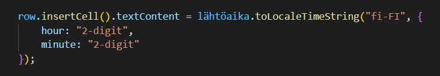

# project_2: Työmatka junailua

**Author(s):** Jenni Isokääntä

## Project plan

### Project idea

Sivulta on mahdollista katsoa tiettyjen asemian juna-aikataulua: Huopalahdesta päärautatieasemalle sekä Helsingistä Myyrmäkeen.

### Planned features

List at least three features you plan to include in your application:

- Nähdä kellonaika milloin juna lähtee asemalta
- Nähdä mikä juna on kyseessä
- Nähdä raide, jolta juna on lähdössä
- Nähdä kellonaika, jolloin juna saapuu reitin päätepysäkille

### Wireframe / sketch

)

## Web links

- **Published application:** [Add your GitHub Pages URL here](https://jenn-i-i.github.io/project_2/)
- **GitHub repository:** [Add your repository URL here](https://github.com/Jenn-i-I/project_2.git)
- **Project video presentation:** [Add your video URL here](https://video.laurea.fi/media/Project2+esittely+video/0_hkkxnond)

## About the application

**[Töihin junalla]** on web sovellus, jolla voi tarkastella junien aikataulua tietyiltä ennaltasovituilta asemilta. Eli sovellus on suunniteltu henkilökohtaiseen käyttöön.

## Technologies

Describe the technologies you used and their role in your project.

- HTML – page structure
- CSS – styling and layout
- JavaScript – functionality, DOM scripting and form validation

## How to use the application

Write short instructions for using the application.

1. Open the published application using the link above.
2. Click the button.
3. See result.

## Running the application locally

1. Clone or download this repository to your computer.
2. Open the project folder.
3. Open `index.html` in a web browser.

## Screenshots

Add at least one screenshot of your working application.

Example:

)
)

## Known issues / limitations

No known issues.

## Self-assessment and learning reflection

Reflect on your work and learning process.

- Onnistuin saamaan sovelluksen toimimaan haluamallani tavalla. Haasteena oli löytää Fintrafficin sivuilta oikea tieto. Yritin ensin luoda sovellusta käyttäen tähän tarkoitukseen väärää URL:ia eli reittiperusteista hakua. Tähän sai syötettyä kivasti haluamani asemat, mutta kyseinen URL haki aina asemien ensimmäiset lähdöt, ei nykyistä tilannetta.

- Ulkonäköä voisi kehittää, lisäksi valmiiksi määriteltyjen asemien lisäksi sivustolla voisi olla mahdollisuus hakea jonkun toisen aseman tilannetta. Nyt tämä versio näyttää siis ainoastaan useimmiten käyttämäni reitit.

- Opin etsimään tarvitsemaani tietoa. Käytin kehitysvaiheessa paljon console.log() toimintoa, jotta pääsin näkemään mitä tietoa URL:sta saadaan.

- My self-assessed project grade: 8/10

## Sources and acknowledgements

List all sources, tutorials, images and code examples used in your project.

Hyödynsin workshop materiaalia sekä muuta kurssimateriaalia. Lisäksi hyödynsin W3Schools materiaalia (https://www.w3schools.com/css/default.asp) erityisesti tyylin luomisessa.

- AI tool used: Copilot
  - How the tool was used:
  Copilotin avulla selvitetty, miten saa tämän hetken päivämäärän ja kellonajan selvitettyä ja miten kellonajan saa tulostumaan oikein. 
  Tekoälyn avulla varmistettu, että koodin kehitys on menossa oikeaan suuntaan. Lisäksi tarvittu tekoälyltä opastusta siinä, että saadaan aineistosta noukittua halutut junat.
